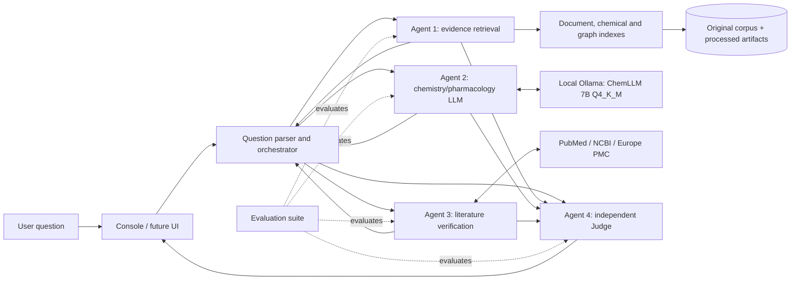

# Best Life AI Architecture

Status: **All four agent modules, orchestration, and integrated console are implemented; expanded evaluation and final scientific review remain pending.** Initial scientific scope is paracetamol (acetaminophen) only. Interfaces remain modular for future drugs; multi-drug behavior is not implemented.

## System overview

Solid arrows are data flow. The Judge receives source evidence, the drafted answer, and verification results independently. The Judge may abstain, identify unsupported claims, or request retrieval/verification again; it does not adopt the LLM answer automatically.

## Current implementation

`main.py` and `agents/knowledge_agent.py` now load the paracetamol corpus recursively through `agents/document_ingestion.py`, preserve source/page/section metadata, and retain the existing SentenceTransformer, cosine, BM25, reciprocal-rank fusion, and provisional evidence labels. `agents/chemical_processing.py` adds PubChem JSON/SDF parsing with RDKit validation. `agents/knowledge_graph.py` builds a provenance-first evidence graph whose concept edges are explicitly lexical and not scientific assertions. The console displays source IDs, URLs, identifiers, reuse notes, and evidence IDs when available. OCR output from the repeated scan-only pages is recorded for audit and excluded from retrieval until verified.

Agent 1 passed its initial 10-question retrieval acceptance. Agents 2?4, the orchestrator, and `app.py` have initial tested implementations; one live end-to-end formula question completed. The expanded 17-case retrieval evaluation passed. None of these checks establish scientific accuracy.

## Component responsibilities

### Agent 1 — Scientific Knowledge Graph Agent

Owns local source ingestion and evidence retrieval. Implemented pipeline stages include recursive PDF/TXT/JATS XML ingestion; source-manifest metadata and SHA-256 preservation; page/section extraction; pypdfium2 rendering and Tesseract diagnostic OCR; chemistry JSON/SDF parsing and RDKit validation; chunking/embeddings; BM25 and semantic reciprocal-rank fusion; evidence/source traceability; and a serialized, local provenance graph. The graph currently links paracetamol, source, extracted evidence, and lexically mentioned concepts. It does not assert scientific relations or infer mechanisms. Keep original data immutable. Unverified OCR and sources with restricted or unknown reuse conditions remain locally traceable and are not redistributed. A graph database, advanced reranking, and claim-level scientific validation remain future work.

### Agent 2 — Chemistry and Pharmacology LLM Agent

Implemented in `agents/chemistry_pharmacology_agent.py`. Receives the user question plus retrieved evidence, metadata, and explicit uncertainty. Connect to the existing Ollama service through its local HTTP chat API, exact configured model `hf.co/ceafgnigguh123/ChemLLM-7B-Chat-GGUF:Q4_K_M`. Return structured claim objects with evidence IDs and wording that distinguishes established results, hypotheses, disagreement, and unknowns. The model must not create citations or supply medical advice/dosing unsupported by retrieved sources. Keep an `LLMClient` interface so the model can be replaced. The shared `agents/ollama_client.py` is implemented and both exact configured models passed live low-token chat smoke checks. Agent 2 mocked tests and one live evidence-grounded integration passed; output is a draft and not scientific validation.

### Agent 3 — Scientific Literature Verification Agent

Implemented in `agents/literature_verification_agent.py`; live query to both providers succeeded. Searches PubMed using NCBI E-utilities and Europe PMC REST and retrieves candidate metadata/abstracts with PMID, PMCID, DOI, date, journal, URL and reuse fields when provided. Current implementation does not download full text; it records open-access/license metadata for later review. It returns candidates, not an unsupported claim-support verdict. Respect service terms/rate limits, set a descriptive User-Agent, and do not bypass access restrictions.

### Agent 4 — Judge Agent

Implemented in `agents/judge_agent.py` with the exact configured `llama3.2:3b` model. It combines structured review with deterministic evidence-ID, insufficient-evidence, and AMPA/APABA plus NAPQI safeguards. Seven mocked tests and one live fail-closed check passed.

Compares each answer claim with Agent 1 records and Agent 3 literature candidates. It may qualify or reject claims or abstain; it does not assert that retrieval results prove the claim. No uncalibrated numeric confidence is emitted.

## Orchestration and failure handling

`agents/orchestrator.py` runs the ordered Agent 1 ? Agent 2 ? Agent 3 ? Agent 4 flow, stops on insufficient local evidence, records raw model outputs, per-stage timings, and stage errors in per-run JSON audit files under `data/processed/runs/`, and fails closed on stage errors. `app.py` provides the integrated console; five mocked orchestrator tests pass and verify per-stage timing/audit data. One live four-stage console check completed with an approved chemical-property claim and source traceability. Broader evaluation remains pending.

The orchestrator normalizes the question and requests retrieval first. Agent 1 errors or empty evidence yield an insufficient-evidence response or abstention; the workflow must not call Agent 2 with an empty context as though it had evidence. Agent 2 timeouts/model-not-found errors are explicit and do not get silently replaced by fabricated output. Agent 3 API timeouts/rate limiting return partial status; requests are paced conservatively and are not silently retried. If verification is unavailable, the Judge labels external verification missing. Agent 4 failures must not silently pass the draft; return a clearly marked unreviewed status or abstain. Preserve original exceptions in logs without credentials or sensitive user data.

See `AGENT_INTERFACES.md`, `DATA_SCHEMA.md`, `SYSTEM_WORKFLOW.md`, and `EVALUATION_METHODOLOGY.md` for proposed contracts and acceptance measures.
Project-local package versions and verified wheel hashes are recorded in `AGENT1_DEPENDENCIES.md`.

## Storage and resource plan

- Preserve source files under `data/research/paracetamol`; record every acquired file in `SOURCE_MANIFEST.csv` and `data/research/paracetamol/metadata/acquisition_log.csv`.
- Store derived extraction/chunks/embeddings/graph under `data/processed/` and `data/knowledge_graph/`; keep generated artifacts reproducible and disposable without affecting sources.
- Start with batch embedding of document chunks and a local NumPy/BM25 index; avoid an always-running vector database unless corpus size/evaluation justifies it.
- On the 16 GB RAM / 6 GB VRAM laptop, keep embedding/model batch sizes conservative, make GPU use optional, and run Llama through Ollama rather than loading a second large model into Python memory.
- No heavy dependencies were installed during the research milestone.

## Latest evaluation checkpoint (2026-11-01)

The system retrieval evaluation contains 18 cases and the latest automated regression passes 40 tests. These verify software behavior, retrieval coverage and traceability, not scientific claim correctness. A current Europe PMC HTTP 503 is represented as partial verification. The last live end-to-end model/API run predates stage timing display; that display is covered by automated tests.
