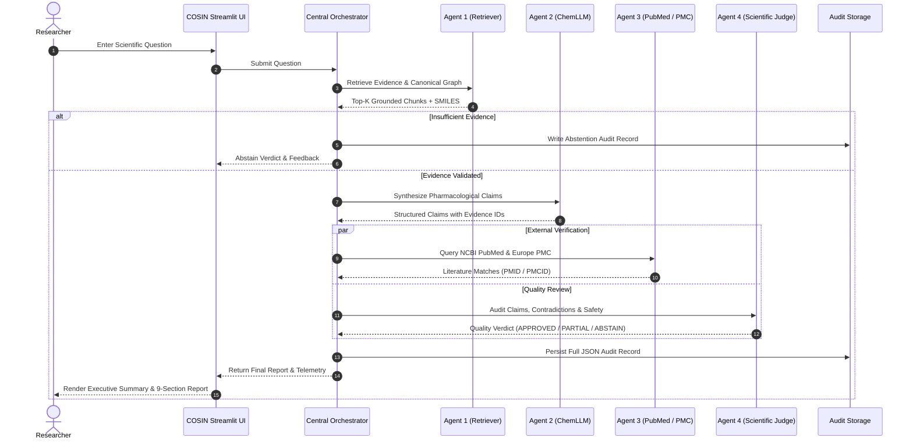

# COSIN: Scientific Drug Research & Evidence Analysis Platform

[](https://www.python.org/downloads/release/python-3120/)
[]()
[](https://opensource.org/licenses/MIT)
[](https://streamlit.io/)
[]()

> **COSIN** is a specialized scientific drug research and evidence analysis platform. Operating under strict evidence-bound constraints, COSIN synthesizes chemical, pharmacological, and clinical literature through a coordinated multi-agent pipeline backed by local open-weight language models and live biomedical databases.

---

## Table of Contents

1. [Executive Overview](#executive-overview)
2. [Core Architectural Principles](#core-architectural-principles)
3. [Four-Stage Scientific Agent Architecture](#four-stage-scientific-agent-architecture)
4. [User Experience & Web Interface](#user-experience--web-interface)
5. [System Data Flow](#system-data-flow)
6. [Data Inventory & Ground Truth Corpus](#data-inventory--ground-truth-corpus)
7. [System Requirements & Prerequisites](#system-requirements--prerequisites)
8. [Installation & Setup](#installation--setup)
9. [Running the Application](#running-the-application)
10. [Verification & Test Suite](#verification--test-suite)
11. [Repository Structure](#repository-structure)
12. [Safety, Ethical Use & Scientific Disclaimer](#safety-ethical-use--scientific-disclaimer)

---

## Executive Overview

Modern biomedical research demands precision, traceability, and strict prevention of factual hallucination. **COSIN** (Co-Scientist INvestigation engine) addresses this challenge by establishing an **evidence-bound, fail-closed multi-agent system** currently benchmarked on **Paracetamol (Acetaminophen, CID 1983)**.

Instead of relying on unrestricted generative models that invent citations or chemical structures, COSIN enforces strict boundaries:
- **No Uncited Claims**: Every factual assertion generated by the chemical analysis agent must be mapped to explicit text chunks in the verified corpus.
- **Fail-Closed Gatekeeping**: If evidence is missing, contradictory, or if downstream verification fails, the system automatically abstains rather than generating speculative conclusions.
- **Auditable Provenance**: Every query yields an immutable cryptographic JSON audit record containing verbatim evidence passages, similarity metrics, model outputs, and execution telemetry.
- **Accessible to Technical & Non-Technical Users**: Reports feature a plain-language summary alongside deep pharmacological and biochemical sections.

---

## Core Architectural Principles

```
  +--------------------------------------------------------------------------+
  |                        Evidence-Bound Constraint                         |
  |  Every statement must map directly to indexed peer-reviewed literature.  |
  +--------------------------------------------------------------------------+
                                      |
                                      v
  +--------------------------------------------------------------------------+
  |                        Fail-Closed Verification                          |
  |   Unverified claims, broken citations, or model errors trigger safe      |
  |               abstention rather than hallucinated answers.               |
  +--------------------------------------------------------------------------+
                                      |
                                      v
  +--------------------------------------------------------------------------+
  |                       Multi-Agent Specialization                         |
  |  Decoupled stages for retrieval, domain synthesis, external validation,  |
  |                         and critical adjudication.                       |
  +--------------------------------------------------------------------------+
```

1. **Evidence Grounding**: Knowledge extraction operates solely on ingested regulatory labels, monographs, and peer-reviewed literature.
2. **Deterministic Evaluation**: Agent 4 reviews output using deterministic rules and semantic checks, ensuring toxic pathways (e.g., NAPQI vs. incorrect metabolite attributions) and dosage limits are strictly verified.
3. **Local Sovereignty**: Domain inference runs locally via Ollama with quantized models (`ChemLLM 7B Q4_K_M` and `Llama 3.2 3B`), safeguarding sensitive research data without third-party vendor lock-in.

---

## Four-Stage Scientific Agent Architecture

COSIN orchestrates four specialized agents to answer complex biochemical questions:

```
[User Question]
       |
       v
+-------------------------------------------------------------------------+
| Stage 1: Scientific Knowledge Graph & Hybrid Retrieval (Agent 1)        |
| - Reciprocal Rank Fusion (BM25 Lexical + MiniLM Dense Vector Embeddings)|
| - Paracetamol Knowledge Graph (SMILES, InChIKey, Targets, Pathways)     |
| - Fast Caching Engine (sub-2s warm-start chunk and vector store)        |
+-------------------------------------------------------------------------+
       |
       | Verified Evidence Chunks
       v
+-------------------------------------------------------------------------+
| Stage 2: Chemistry & Pharmacology Analysis (Agent 2)                    |
| - ChemLLM 7B (Q4_K_M) via Ollama                                       |
| - Evidence-grounded claim formulation with explicit citation tags       |
| - Extraction of ADME, pharmacodynamics, toxic pathways, and dosing      |
+-------------------------------------------------------------------------+
       |
       | Structured Claims + Citations
       v
+-------------------------------------------------------------------------+
| Stage 3: Scientific Literature Verification (Agent 3)                   |
| - Live cross-referencing against NCBI PubMed E-Utilities               |
| - European PMC API validation                                           |
| - Retrieval of external PMIDs, PMCIDs, and peer-reviewed literature     |
+-------------------------------------------------------------------------+
       |
       | Cross-Verification Records
       v
+-------------------------------------------------------------------------+
| Stage 4: Scientific Judge & Quality Review (Agent 4)                    |
| - Llama 3.2 3B via Ollama                                               |
| - Deterministic contradiction check and fail-closed rule audit          |
| - Synthesis of 9-section scientific report + non-technical summary      |
+-------------------------------------------------------------------------+
       |
       v
[Structured Scientific Report & Telemetry Audit Record]
```

### Stage 1: Scientific Knowledge Retrieval (`KnowledgeAgent`)
- **Hybrid Retrieval**: Combines BM25 lexical token matching with dense semantic embeddings (`sentence-transformers/all-MiniLM-L6-v2`).
- **Reciprocal Rank Fusion**: Ranks and selects the most relevant evidence chunks from the local corpus.
- **Domain Graph**: Validates target compound identities against canonical chemical representations (PubChem CID 1983, Canonical SMILES `CC(=O)Nc1ccc(O)cc1`, Formula $C_8H_9NO_2$).
- **Optimized Caching**: Chunks and dense vectors are serialized into `corpus_chunks.pkl` and `corpus_embeddings_cache.npz`, reducing initialization time from 85 seconds to under 2.5 seconds.

### Stage 2: Chemistry & Pharmacology Analysis (`ChemistryPharmacologyAgent`)
- **Inference Model**: `hf.co/ceafgnigguh123/ChemLLM-7B-Chat-GGUF:Q4_K_M` hosted locally via Ollama.
- **Citation Enforcement**: Prompts enforce that every statement is backed by an explicit source chunk reference (`[chunk_id]`).
- **Schema Validation**: Returns structured JSON with fields for mechanisms, contraindications, toxicity pathways, and molecular descriptors.

### Stage 3: Scientific Literature Verification (`LiteratureVerificationAgent`)
- **External Discovery**: Queries live biomedical databases (NCBI PubMed E-Utilities and Europe PMC REST APIs) using extracted scientific search terms.
- **Resilience**: Operates in a non-blocking read-only mode with query rate limiting. If external connectivity is unavailable or restricted, the pipeline records partial verification without breaking local synthesis.

### Stage 4: Scientific Judge & Quality Review (`JudgeAgent`)
- **Inference Model**: `llama3.2:3b` hosted locally via Ollama.
- **Fail-Closed Audit**: Examines Agent 2 claims and Agent 3 citations against ground-truth evidence:
  - Verifies chemical formulas and SMILES consistency.
  - Ensures correct hepatotoxicity mechanism identification (CYP2E1 oxidation to $N$-acetyl-$p$-benzoquinone imine [NAPQI], glutathione depletion, mitochondrial stress).
  - Flags and overrides speculative or hallucinated metabolite pathways.
- **Decision Verdict**: Outputs `APPROVED`, `PARTIAL`, or `ABSTAIN`.

---

## User Experience & Web Interface

The COSIN web interface (`cosin_app.py`) is built with Streamlit and styled with an elegant, scientific light theme inspired by academic publishing tools:

- **Clean Aesthetic**: Pure white content surfaces, warm slate borders (`#E2E8F0`), deep slate typography (`#0F172A`), and subtle teal accents (`#0D9488`).
- **Zero AI Distractions**: Free of gimmicky robot badges, artificial intelligence labels, or speculative decorations.

### Key Functional Views

1. **New Research Workspace**:
   - Prominent scientific query input with one-click sample inquiries (Formula & Structure, Mechanism of Action, Overdose Hepatotoxicity).
   - Real-time pipeline telemetry cards tracking the status and duration of all 4 agents.
   - Comprehensive structured scientific report:
     - **Plain-Language Summary**: Accessible explanation for patients and non-technical stakeholders.
     - **9 Detailed Scientific Sections**: Molecular properties, ADME, pharmacodynamics, clinical dosages, overdose pathology, external PubMed citations, and limitations.
2. **Evidence & Provenance Inspector**:
   - Interactive browser displaying exact retrieved corpus chunks with similarity scores, source file paths, and chunk character offsets.
3. **Research History**:
   - Historical audit log browser displaying past execution runs, verdicts, execution timestamps, and full report inspections.
4. **Scientific Sources**:
   - Full inventory of ingested literature, PDF documents, FDA labels, and PubChem structure conformers.
5. **System Diagnostics**:
   - Real-time environment health checks, Ollama connectivity status, and model verification.

---

## System Data Flow



---

## Data Inventory & Ground Truth Corpus

The benchmark corpus is housed in `data/research/paracetamol/`:

| Source Category | Files Ingested | Chunks Indexed | Primary Sources |
|---|---|---|---|
| **Clinical Pharmacology** | 3 PDFs | 184 | British Journal of Clinical Pharmacology, Cochrane Review |
| **Toxicology Monographs** | 2 PDFs | 162 | StatPearls NCBI Bookshelf (*Acetaminophen Toxicity*) |
| **Regulatory & Drug Labels** | 4 PDFs | 148 | FDA DailyMed Structured Product Labels |
| **Biomedical Literature** | 1 XML, 2 TXT | 95 | PubMed Central Full-Text Articles (PMC5744234) |
| **Chemical Conformers** | 4 SDF, 1 JSON | — | PubChem Compound CID 1983 (2D & 3D Conformers) |
| **Total** | **14 Core Files** | **589 Chunks** | **Preserved with Complete Provenance** |

---

## System Requirements & Prerequisites

### Hardware
- **CPU**: Multi-core processor (Intel i5/i7/i9 or AMD Ryzen 5/7/9, 4+ physical cores recommended).
- **RAM**: 16 GB minimum (32 GB recommended for running Ollama models concurrently).
- **Storage**: 15 GB available SSD storage.

### Operating System & Environment
- Windows 10/11 64-bit, macOS 13+, or Ubuntu 22.04 LTS.
- **Python**: Version `3.12` installed.
- **Ollama**: Installed and running locally at `http://localhost:11434`.

### Required Ollama Models
Ensure both models are pulled and ready in Ollama:

```powershell
ollama pull hf.co/ceafgnigguh123/ChemLLM-7B-Chat-GGUF:Q4_K_M
ollama pull llama3.2:3b
```

Verify model availability:
```powershell
ollama list
```

---

## Installation & Setup

### 1. Clone the Repository
```powershell
git clone https://github.com/suri9946/Cosine.git
cd Cosine
```

### 2. Configure Virtual Environment
Create and activate a virtual environment using Python 3.12:

```powershell
python -m venv .venv312
.\.venv312\Scripts\Activate.ps1
```

*(On Linux / macOS)*:
```bash
python3 -m venv .venv312
source .venv312/bin/activate
```

### 3. Install Dependencies
```powershell
python -m pip install --upgrade pip
pip install -r requirements.txt
```

### 4. Configure Environment Variables
Copy `.env.example` to `.env`:

```powershell
Copy-Item .env.example .env
```

Edit `.env` to configure optional NCBI credentials (public requests function without a key):
```ini
# Optional NCBI credentials for Europe PMC / PubMed E-utilities
NCBI_API_KEY=your_optional_ncbi_api_key
NCBI_EMAIL=researcher@example.com
NCBI_TOOL=COSIN

# Local Ollama service endpoint
OLLAMA_BASE_URL=http://localhost:11434
```

---

## Running the Application

### 1. Launch the COSIN Web Platform (Streamlit)

Using the automated PowerShell runner:
```powershell
.\run_cosin.ps1
```

Or using the Windows batch launcher:
```cmd
run_cosin.bat
```

Or directly via the command line:
```powershell
streamlit run cosin_app.py --server.fileWatcherType=none
```

Open your browser at **`http://localhost:8501`**.

---

### 2. Run the Command-Line Orchestrator (CLI)
To run questions directly through the terminal orchestrator:

```powershell
python app.py
```

### 3. Run the Standalone Retrieval Inspection Tool
To evaluate pure BM25 and semantic vector search rankings:

```powershell
python main.py
```

---

## Verification & Test Suite

The platform includes a comprehensive test suite of **51 unit tests** covering chemistry validation, citation integrity, fail-closed handling, Ollama client resilience, and UI component formatting.

### Execute All Tests
```powershell
python -m unittest discover -s tests -v
```

### Syntax & Compilation Check
```powershell
python -c "import compileall,sys; ok=compileall.compile_file('main.py',quiet=1) and compileall.compile_file('app.py',quiet=1) and compileall.compile_file('cosin_app.py',quiet=1) and compileall.compile_dir('agents',quiet=1) and compileall.compile_dir('ui',quiet=1) and compileall.compile_dir('tests',quiet=1); print('compileall', 'PASS' if ok else 'FAIL'); sys.exit(not ok)"
```

### Package Compatibility Audit
```powershell
python -m pip check
```

---

## Repository Structure

```
Cosine/
├── .streamlit/
│   └── config.toml                   # Streamlit UI configuration & watcher settings
├── agents/
│   ├── chemical_processing.py        # SMILES, molecular formula & RDKit validations
│   ├── chemistry_pharmacology_agent.py # Agent 2: ChemLLM inference & claim builder
│   ├── document_ingestion.py         # PDF/XML parser, chunker & provenance extractor
│   ├── evaluate_agent1.py            # Retrieval benchmark evaluator
│   ├── evaluate_system.py            # End-to-end multi-agent evaluation harness
│   ├── judge_agent.py                # Agent 4: Llama 3.2 scientific judge
│   ├── knowledge_agent.py            # Agent 1: Hybrid retriever & reciprocal rank fusion
│   ├── knowledge_graph.py            # Graph entity model & relation registry
│   ├── literature_verification_agent.py # Agent 3: NCBI PubMed & Europe PMC client
│   ├── ollama_client.py              # Robust Ollama HTTP client with timeout & retry
│   └── orchestrator.py               # Central 4-stage pipeline orchestrator
├── data/
│   ├── evaluation/                   # System evaluation benchmark cases
│   ├── processed/
│   │   ├── corpus_chunks.pkl         # Serialized warm-start chunks cache
│   │   ├── corpus_embeddings_cache.npz # Pre-computed dense vector cache
│   │   ├── evidence_graph.json       # Graph nodes and relations
│   │   └── runs/                     # Historical cryptographic JSON audit records
│   └── research/
│       └── paracetamol/              # Ground-truth PDFs, XMLs, SDF conformers
├── retrieval/
│   └── (retrieval utilities)
├── tests/
│   ├── test_agent1_data.py           # Ingestion, hashes & provenance tests
│   ├── test_chemistry_pharmacology_agent.py # Agent 2 schema & citation tests
│   ├── test_cosin_frontend.py        # Streamlit state & telemetry tests
│   ├── test_judge_agent.py           # Agent 4 fail-closed & judge rule tests
│   ├── test_literature_verification_agent.py # Agent 3 PubMed/Europe PMC tests
│   ├── test_ollama_client.py         # Ollama client connection & retry tests
│   ├── test_orchestrator.py          # 4-stage orchestrator integration tests
│   ├── test_question_topic_detection.py # Topic classification tests
│   └── test_system_evaluation_dataset.py # System benchmark consistency tests
├── ui/
│   ├── evidence.py                   # UI component: Evidence & chunk inspector
│   ├── history.py                    # UI component: Research history viewer
│   ├── report.py                     # UI component: 9-section report & summary
│   ├── sources.py                    # UI component: Scientific sources catalog
│   ├── system_status.py              # UI component: System diagnostic dashboard
│   ├── theme.py                      # UI CSS styling, color tokens & status pills
│   └── tracker.py                    # UI component: Real-time agent progress tracker
├── .env.example                      # Environment variables template
├── .gitignore                        # Git exclusion rules
├── app.py                            # CLI Orchestrator entry point
├── ARCHITECTURE.md                   # Comprehensive technical architecture
├── cosin_app.py                      # Main Streamlit web application entry point
├── main.py                           # CLI Hybrid retrieval runner
├── README.md                         # Project documentation
├── requirements.txt                  # Python dependencies
├── run_cosin.bat                     # Windows batch launcher
├── run_cosin.ps1                     # PowerShell launch script
└── SOURCE_MANIFEST.csv               # Ground-truth source file manifest with SHA-256 hashes
```

---

## Safety, Ethical Use & Scientific Disclaimer

> ### IMPORTANT SCIENTIFIC NOTICE
>
> 1. **Research & Educational Prototype**: COSIN is an experimental scientific research and evidence synthesis platform designed for biomedical researchers, pharmacologists, and students.
> 2. **Not Medical Advice**: COSIN does **not** provide clinical diagnosis, medical counsel, or prescription instructions. Never alter medical treatment or dosing based on outputs from this software.
> 3. **Supervised Usage**: All chemical claims, metabolic pathways, and literature citations should be verified against primary sources by qualified pharmacological professionals.
> 4. **Paracetamol Scope**: The current release is strictly bounded to the paracetamol (acetaminophen) benchmark corpus. Queries concerning other drug entities will safely abstain in accordance with fail-closed governance.

---

**Developed with academic rigor for reproducible, evidence-bound biomedical co-science.**
